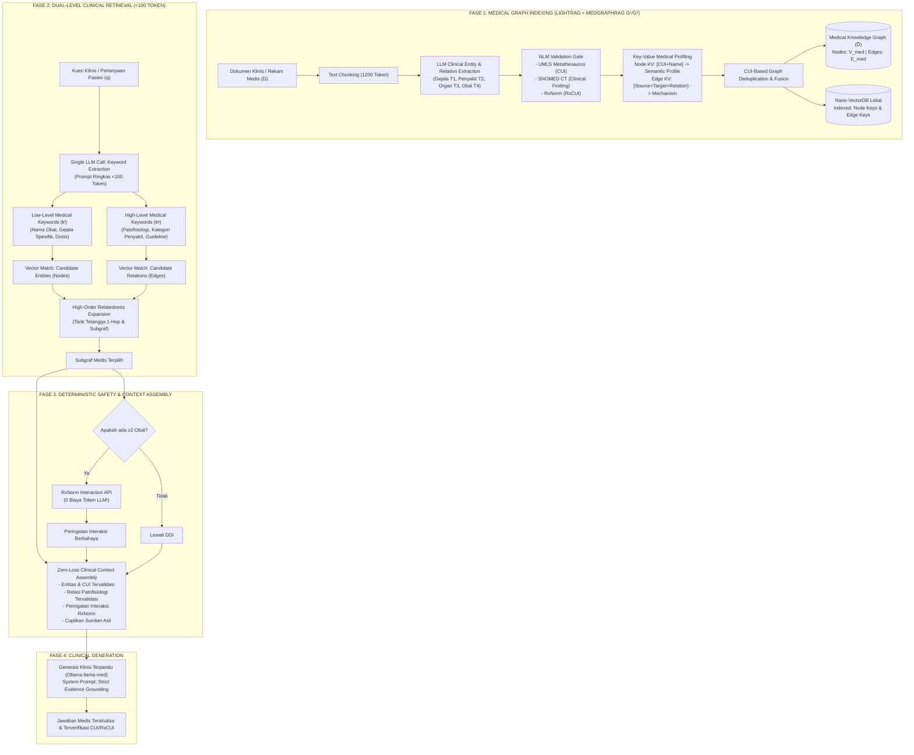
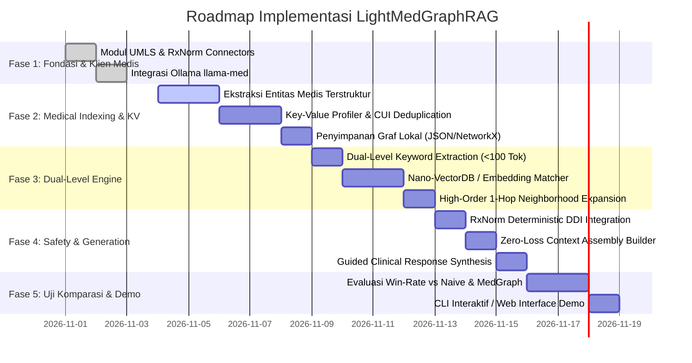

# LightMedGraphRAG: Cetak Biru Arsitektur & Rencana Implementasi
## Penggabungan Efisiensi Token LightRAG dengan Ketelitian Pemrosesan Medis MedGraphRAG

---

### 📌 Metadata Proyek
* **Nama Proyek:** **LightMedGraphRAG** (*Lightweight Medical Graph Retrieval-Augmented Generation*)
* **Inspirasi Fondasi:**
  1. **LightRAG (HKU & BUPT - EMNLP 2025):** Efisiensi token ekstrem (<100 token/query), 1 API call keyword extraction, Key-Value graph profiling, dual-level retrieval (low-level & high-level), serta pembaruan graf inkremental (tanpa re-indexing).
  2. **MedGraphRAG (ACL 2025):** Hierarki graf medis multi-lapis ($G^1$ teks sumber, $G^2$ ontologi medis baku UMLS/SNOMED CT/RxNorm, $G^3$ relasi patofisiologi lintas dokumen), perakitan bukti tanpa distorsi (*zero-loss evidence assembly*), dan validasi deterministik interaksi obat berbahaya.
* **Target Lingkungan Eksekusi:** Laptop / Workstation Riset BRIN (GPU Lokal / CPU Mode via Ollama `llama-med`, UMLS REST API, RxNorm REST API).
* **Lokasi Dokumen:** `c:\Magang BRIN\Belajar_RAG\LightRAG_medis\`

---

## 🧭 Daftar Isi
1. [Jawaban Fundamental: Apakah Penggabungan Ini Bisa Dilakukan?](#1-jawaban-fundamental-apakah-penggabungan-ini-bisa-dilakukan)
2. [Sintesis Dua Paradigma: Mengapa Keduanya Saling Melengkapi?](#2-sintesis-dua-paradigma-mengapa-keduanya-saling-melengkapi)
3. [Arsitektur Lengkap LightMedGraphRAG](#3-arsitektur-lengkap-lightmedgraphrag)
4. [Rincian Komponen Pipeline 5 Tahap](#4-rincian-komponen-pipeline-5-tahap)
   - [Tahap 1: Medical-Aware Indexing & UMLS/RxNorm Grounding (Lapis G¹ & G²)](#tahap-1-medical-aware-indexing--umlsrxnorm-grounding-lapis-g¹--g²)
   - [Tahap 2: Key-Value Medical Graph Profiling & CUI Deduplication](#tahap-2-key-value-medical-graph-profiling--cui-deduplication)
   - [Tahap 3: Dual-Level Clinical Keyword Extraction (<100 Token Query)](#tahap-3-dual-level-clinical-keyword-extraction-100-token-query)
   - [Tahap 4: Deterministic Safety Check & High-Order Graph Expansion](#tahap-4-deterministic-safety-check--high-order-graph-expansion)
   - [Tahap 5: Zero-Loss Context Assembly & Clinical LLM Generation](#tahap-5-zero-loss-context-assembly--clinical-llm-generation)
   - [Fitur Tambahan: Seamless Incremental Clinical Knowledge Update](#fitur-tambahan-seamless-incremental-clinical-knowledge-update)
5. [Formulasi Matematis Sistem Hibrida](#5-formulasi-matematis-sistem-hibrida)
6. [Analisis Efisiensi Komputasi & Anggaran Token](#6-analisis-efisiensi-komputasi--anggaran-token)
7. [Matriks Perbandingan Akbar 5 Sistem RAG](#7-matriks-perbandingan-akbar-5-sistem-rag)
8. [Roadmap Tahapan Implementasi (Rencana Aksi Bertahap)](#8-roadmap-tahapan-implementasi-rencana-aksi-bertahap)
9. [Struktur Berkas Proyek di Direktori `LightRAG_medis`](#9-struktur-berkas-proyek-di-direktori-lightrag_medis)

---

## 1. Jawaban Fundamental: Apakah Penggabungan Ini Bisa Dilakukan?

> **Jawaban Tegas: SANGAT BISA, dan ini merupakan terobosan inovasi riset yang luar biasa orisinal untuk dipublikasikan atau dipresentasikan di BRIN!**

### Mengapa Ini Sangat Rasional dan Feasible?
* **LightRAG** menyelesaikan masalah **bottleneck komputasi dan biaya token** pada Graph RAG konvensional (seperti Microsoft GraphRAG) dengan membuang algoritma clustering komunitas Leiden yang boros token, menggantinya dengan **representasi Key-Value (KV) yang diindeks secara vektor** dan **Dual-Level Retrieval**.
* **MedGraphRAG** menyelesaikan masalah **akurasi dan keselamatan klinis** dengan memetakan entitas mentah ke kode baku internasional (**UMLS CUI, SNOMED CT, RxCUI**) dan memeriksa interaksi obat fatal secara deterministik.
* **LightMedGraphRAG** mengambil *mekanisme efisiensi LightRAG* sebagai mesin penggerak indeks dan retrieval, tetapi *isi struktur data dan logikanya* dipandu oleh ontologi dan keselamatan klinis MedGraphRAG.

---

## 2. Sintesis Dua Paradigma: Mengapa Keduanya Saling Melengkapi?

```
┌────────────────────────────────────────────────────────────────────────────────────────┐
│                        DILEMA & SINERGI DUA METODE BESAR                               │
├───────────────────────────────────────────┬────────────────────────────────────────────┤
│           LIGHTRAG ASLI (OPEN-DOMAIN)     │         MEDGRAPHRAG ASLI (BIOMEDIS)        │
├───────────────────────────────────────────┼────────────────────────────────────────────┤
│ 🟢 Sangat hemat token (<100 token/query)   │ 🔴 Relatif boros token jika traversal graf │
│ 🟢 Hanya butuh 1 panggilan LLM saat query │    multi-lapis dilakukan dengan LLM prompt │
│ 🟢 Pembaruan inkremental instan           │ 🔴 Pembangunan ulang graf hierarki rumit   │
│ 🔴 Ekstraksi entitas umum (bebas/liar)    │ 🟢 Standardisasi medis ketat (CUI/RxCUI)   │
│ 🔴 Buta farmakologi & terminologi medis   │ 🟢 Deteksi interaksi obat (DDI) akurat     │
│ 🔴 Deduplikasi teks berbasis string biasa │ 🟢 Bebas halusinasi via bukti terverifikasi│
├───────────────────────────────────────────┴────────────────────────────────────────────┤
│                                          ▼                                             │
│                     HASIL PENGGABUNGAN: **LIGHTMEDGRAPHRAG**                           │
│  "Pemrosesan Medis Seketat MedGraphRAG + Kecepatan & Efisiensi Token Sehemat LightRAG"  │
└────────────────────────────────────────────────────────────────────────────────────────┘
```

1. **Deduplikasi Entitas Lebih Sempurna:**  
   Pada LightRAG asli, deduplikasi dilakukan secara leksikal/LLM bebas (kata "sesak napas", "dyspnea", dan "shortness of breath" bisa saja gagal disatukan jika prompt LLM tidak konsisten). Pada LightMedGraphRAG, ketiga istilah langsung dipetakan ke identitas tunggal UMLS: `C0013404`. Deduplikasi graf menjadi $100\%$ matematis dan presisi!
2. **Efisiensi Token Ekstrem untuk Data Medis:**  
   Alih-alih memanggil LLM berulang kali untuk mengevaluasi relasi hierarkis dokumen klinis, kita memanfaatkan **Dual-Level Keyword Matching (Low-Level untuk entitas penyakit/obat, High-Level untuk sindrom/patofisiologi)** yang berjalan di atas Vector Database lokal (Nano-VectorDB). LLM hanya dipanggil **1 kali** untuk mengekstrak kata kunci dan **1 kali** untuk menyintesis jawaban akhir.
3. **Penyaring Keamanan Deterministik Tanpa Token (Zero Token DDI Filter):**  
   Pengecekan interaksi obat berbahaya dieksekusi langsung oleh algoritma lokal/RxNorm REST API (0 token LLM), lalu hasilnya langsung disuntikkan ke konteks akhir.

---

## 3. Arsitektur Lengkap LightMedGraphRAG

Berikut adalah diagram alir (*end-to-end architecture*) dari sistem hibrida yang akan kita bangun:



---

## 4. Rincian Komponen Pipeline 5 Tahap

### Tahap 1: Medical-Aware Indexing & UMLS/RxNorm Grounding (Lapis G¹ & G²)
Pada LightRAG standar, ekstraksi dilakukan untuk entitas generik (*Person, Organization, Location*). Dalam **LightMedGraphRAG**, kita mengadopsi taksonomi klinis MedGraphRAG:
* $T_1$ : Gejala & Keluhan Pasien (*Signs and Symptoms*).
* $T_2$ : Diagnosis & Penyakit (*Diseases and Syndromes*).
* $T_3$ : Organ & Lokasi Anatomi (*Anatomical Structures*).
* $T_4$ : Obat & Bahan Farmakologis (*Pharmacological Substances*).
* $T_5$ : Prosedur Medis & Terapi (*Therapeutic Procedures*).

**Standardisasi Lapis $G^2$:**  
Setiap entitas yang diekstrak langsung diverifikasi ke server NLM:
1. Gejala/Penyakit $\to$ UMLS REST API $\to$ Dapatkan **CUI** dan terminologi resmi SNOMED CT.
2. Obat $\to$ RxNorm REST API $\to$ Dapatkan **RxCUI** dan bahan aktif generik.

---

### Tahap 2: Key-Value Medical Graph Profiling & CUI Deduplication
LightRAG menggunakan paradigma **Key-Value Indexing**. Kita mengadaptasinya ke ranah medis:

#### A. Node Profiling (Entitas Medis)
* **Index Key ($K_v$):** Gabungan nama baku medis, kode CUI/RxCUI, dan sinonim umum (contoh: `["Sesak napas", "Dyspnea", "Shortness of breath", "CUI:C0013404"]`).
* **Value ($V_v$):** Definisi klinis resmi dari UMLS/SNOMED CT + profil kemunculan entitas dalam dokumen klinis.

#### B. Edge Profiling (Relasi Medis)
* **Index Key ($K_e$):** Pasangan entitas terhubung, jenis relasi patologis (`contraindicated_with`, `causes`, `treats`, `aggravates`), dan tema medis global (contoh: `["Metoprolol", "Salbutamol", "Beta-Blocker vs Beta-Agonist Interaction", "COPD Bronchospasm Risk"]`).
* **Value ($V_e$):** Paragraf mekanisme medis yang menjelaskan mengapa kedua entitas tersebut berinteraksi dan apa bukti klinisnya.

#### C. Deduplikasi Berbasis CUI (*Deterministic Graph Deduplication*)
Jika dua dokumen berbeda menyebut *"Gagal Jantung Kongestif"* dan *"CHF"*, sistem mendeteksi keduanya memiliki `CUI: C0018801`. Kedua node dilebur menjadi satu simpul tanpa redundansi, lalu nilainya dirangkum secara efisien.

---

### Tahap 3: Dual-Level Clinical Keyword Extraction (<100 Token Query)
Ketika seorang klinisi atau pengguna memasukkan kueri klinis:
> *"Pasien lansia mengidap PPOK berat dan hipertensi, sedang mengonsumsi bisoprolol dan formoterol. Mengeluh sesak napas akut. Apakah kombinasi terapi ini aman?"*

Alih-alih langsung mencari seluruh korpus, sistem mengirimkan prompt mikro ke LLM lokal:
```json
{
  "low_level_keywords": ["PPOK", "Hipertensi", "Bisoprolol", "Formoterol", "Sesak napas akut"],
  "high_level_keywords": ["Beta-blocker in COPD", "Bronchodilator efficacy", "Cardiovascular and pulmonary comorbidity"]
}
```
* **Konsumsi Token Prompt:** $<80$ token.
* **Jumlah Panggilan API:** Hanya **1 kali panggilan**.
* **Eksekusi:**
  1. `low_level_keywords` dicocokkan ke Vector DB untuk menemukan **Node Entitas Spesifik** ($T_1, T_2, T_4$).
  2. `high_level_keywords` dicocokkan ke Vector DB untuk menemukan **Edge Relasi Patofisiologi & Guideline**.

---

### Tahap 4: Deterministic Safety Check & High-Order Graph Expansion
1. **High-Order Graph Expansion (1-Hop Subgraph):**  
   Dari simpul-simpul yang cocok, LightMedGraphRAG menelusuri simpul tetangganya di memori. Jika simpul `Bisoprolol` terpilih, tetangga 1-hop seperti `Bronchospasm (Side Effect)` dan `Beta-1 Adrenergic Receptor` otomatis ikut ditarik.
2. **Penyaring Keselamatan Deterministik RxNorm (Zero-Token Cost):**  
   Sistem mengumpulkan semua `RxCUI` yang aktif dari subgraf. Jika ditemukan $\ge 2$ obat, sistem otomatis memanggil fungsi internal `rxnorm_check_interaction()`. Peringatan fatal (kontraindikasi) ditarik langsung dari database farmakologi AS tanpa mengonsumsi token LLM!

---

### Tahap 5: Zero-Loss Context Assembly & Clinical LLM Generation
Sistem merakit teks konteks akhir dengan format *Zero-Loss Context* MedGraphRAG yang sangat padat:
```text
=== VALIDATED CLINICAL ENTITIES (UMLS / SNOMED CT) ===
- Chronic Obstructive Pulmonary Disease (CUI: C0024117)
- Dyspnea, Acute (CUI: C0013404)

=== VALIDATED DRUGS (RxNorm) ===
- Bisoprolol (RxCUI: 1548)
- Formoterol (RxCUI: 25807)

=== ⚠️ DETERMINISTIC DRUG-DRUG INTERACTION WARNING ===
- [CRITICAL]: Bisoprolol (Beta-Blocker) antagonizes the therapeutic effect of Formoterol (Long-acting Beta-2 Agonist) and may induce severe bronchospasm in COPD patients.

=== RELEVANT CLINICAL MECHANISM (Graph Edge Evidence) ===
- Beta-1 blockers, despite being cardioselective, can lose selectivity at therapeutic/high doses, precipitating respiratory arrest in severe COPD patients...
```

Model LLM lokal (`llama-med`) kemudian menghasilkan asesmen medis terstruktur, rekomendasi terapi alternatif, serta mencantumkan sitasi kode CUI/RxCUI.

---

### Fitur Tambahan: Seamless Incremental Clinical Knowledge Update
Jika di masa depan BRIN menambahkan 50 pedoman klinis baru (*Clinical Practice Guidelines*) dari Kemenkes atau WHO:
* Dokumen baru diproses oleh fungsi indexing.
* Dihasilkan graf baru $\hat{\mathcal{D}}' = (\hat{\mathcal{V}}', \hat{\mathcal{E}}')$.
* Penggabungan graf dilakukan via operasi himpunan:
  $$\hat{\mathcal{V}}_{\text{new}} = \hat{\mathcal{V}}_{\text{old}} \cup \hat{\mathcal{V}}', \quad \hat{\mathcal{E}}_{\text{new}} = \hat{\mathcal{E}}_{\text{old}} \cup \hat{\mathcal{E}}'$$
* **Biaya pembaruan:** $0$ token untuk dokumen lama. Sistem tidak perlu *re-clustering* atau re-evaluasi komunitas graf seperti Microsoft GraphRAG!

---

## 5. Formulasi Matematis Sistem Hibrida

Untuk pelaporan ilmiah dan publikasi paper, berikut perumusan formal LightMedGraphRAG:

### 5.1 Definisi Sistem
Sistem LightMedGraphRAG dinotasikan sebagai tuple:

$$\mathcal{M}_{\text{med}} = \Big(\mathcal{G}, \mathcal{R}_{\text{med}} = (\varphi_{\text{med}}, \psi_{\text{dual}})\Big)$$

$$\mathcal{M}_{\text{med}}(q; \mathcal{D}, \mathcal{K}_{\text{UMLS}}, \mathcal{K}_{\text{Rx}}) = \mathcal{G}\Big(q, \psi_{\text{dual}}(q; \hat{\mathcal{D}}_{\text{med}})\Big)$$

### 5.2 Konstruksi Graf Berorientasi Ontologi Medis
Proses indexing $\varphi_{\text{med}}$ melibatkan fungsi normalisasi ontologi $\Omega$:

$$\mathcal{V}, \mathcal{E} = \bigcup_{\mathcal{D}_i \in \mathcal{D}} \text{ExtractMedEntities}(\mathcal{D}_i)$$

$$\mathcal{V}_{\text{grounded}} = \Omega_{\text{UMLS}}(\mathcal{V}), \quad \mathcal{E}_{\text{grounded}} = \Omega_{\text{Rx}}(\mathcal{E})$$

$$\hat{\mathcal{D}}_{\text{med}} = (\hat{\mathcal{V}}, \hat{\mathcal{E}}) = \text{Dedupe}_{\text{CUI}} \circ \text{Prof}_{\text{KV}}(\mathcal{V}_{\text{grounded}}, \mathcal{E}_{\text{grounded}})$$

### 5.3 Dual-Level Medical Retrieval & Subgraf 1-Hop
Diberikan kueri klinis $q$:

$$k^{(l)}, k^{(g)} = \text{LLM}_{\text{extract}}(q)$$

$$\mathcal{V}_{\text{cand}} = \text{TopK}\Big(\cos(\mathbf{e}(k^{(l)}), \mathbf{e}(K_v))\Big), \quad \mathcal{E}_{\text{cand}} = \text{TopK}\Big(\cos(\mathbf{e}(k^{(g)}), \mathbf{e}(K_e))\Big)$$

Subgraf klinis aktif $\mathcal{S}_{\text{active}}$ mencakup ekspansi tetangga 1-hop:

$$\mathcal{S}_{\text{active}} = \{v \in \hat{\mathcal{V}} \mid v \in \mathcal{V}_{\text{cand}} \lor v \in \mathcal{N}(\mathcal{V}_{\text{cand}}) \lor v \in \text{Endpoints}(\mathcal{E}_{\text{cand}})\}$$

### 5.4 Safety Constraint Operator
Konteks akhir diperkaya dengan fungsi pengecekan interaksi obat deterministik $\Delta_{\text{DDI}}$:

$$\mathcal{C}_{\text{final}} = \text{Assembly}\Big(\mathcal{S}_{\text{active}}, \Delta_{\text{DDI}}(\mathcal{V}_{\text{drugs}} \cap \mathcal{S}_{\text{active}})\Big)$$

---

## 6. Analisis Teoretis Kompleksitas Komputasi & Anggaran Token

> ⚠️ **Catatan Integritas Ilmiah untuk Publikasi:**  
> Angka-angka pada tabel di bawah ini merupakan **estimasi analitis berbasis kompleksitas arsitektur teoretis** (*Theoretical Complexity Estimation*), **BUKAN data empiris hasil eksperimen**. Dalam naskah publikasi ilmiah (paper/konferensi), tabel ini akan diisi dengan **data pengukuran aktual (riil)** yang dicatat secara langsung melalui profiler token dan logger API saat uji coba pada dataset benchmark medis (seperti MedQA atau PubMedQA).

Tabel perbandingan kompleksitas teoretis per 1 kueri klinis:

| Komponen Proses | MedGraphRAG Asli | LightRAG Asli | **LightMedGraphRAG (Desain Diusulkan)** |
| :--- | :--- | :--- | :--- |
| **Ekstraksi Keyword Query** | $\mathcal{O}(0)$ (tanpa ekstraksi kata kunci) | $\mathcal{O}(1)$ LLM call (~80 token) | **$\mathcal{O}(1)$ LLM call (~80 token)** |
| **Pencarian Entitas (Low-Level)** | Multiple LLM re-ranking & scoring | K-NN Vector search ($\mathcal{O}(|V|)$) | **K-NN Vector search + CUI Filter ($\mathcal{O}(|V_{\text{med}}|)$)** |
| **Pencarian Relasi (High-Level)**| LLM Community Traversal | K-NN Vector search ($\mathcal{O}(|E|)$) | **K-NN Vector search ($\mathcal{O}(|E_{\text{med}}|)$)** |
| **Safety / Drug Interaction** | LLM inferencing / Rules | Tidak ada modul farmakologi | **Lookup Deterministik RxNorm API (0 token LLM)** |
| **Generasi Jawaban Akhir** | 1 LLM synthesis call | 1 LLM synthesis call | **1 LLM synthesis call (Zero-Loss Prompt)** |
| **Kompleksitas Panggilan LLM** | $\mathcal{O}(K)$ panggilan bertingkat | $\mathcal{O}(1)$ query keyword + 1 synthesis | **Tepat 2 Panggilan LLM (1 Keyword + 1 Synthesis)** |
| **Status Validasi** | Telah Dipublikasikan (ACL 2025) | Telah Dipublikasikan (EMNLP 2025) | **Hipotesis Desain Riset (Akan Diuji Empiris)** |

---

## 7. Matriks Perbandingan Fitur & Karakteristik Arsitektur

| Kriteria Evaluasi | Naive RAG | Microsoft GraphRAG | MedGraphRAG (ACL 2025) | LightRAG (EMNLP 2025) | **LightMedGraphRAG (Proposed)** |
| :--- | :--- | :--- | :--- | :--- | :--- |
| **Representasi Data** | Vektor Chunk Datar | Komunitas Hierarkis Leiden | Graf Medis Multi-Lapis ($G^1, G^2, G^3$) | Graf Key-Value Vektor | **Graf Medis Key-Value ($G^1, G^2, G^3$)** |
| **Domain Spesifik** | Umum | Umum | Khusus Medis | Umum | **Khusus Medis** |
| **Standar Terminologi** | Tidak ada | Tidak ada | UMLS, SNOMED CT, RxNorm | Tidak ada | **UMLS, SNOMED CT, RxNorm** |
| **Deteksi Interaksi Obat** | Tidak ada | Tidak ada | Ya (Deterministik) | Tidak ada | **Ya (Deterministik RxNorm REST API)** |
| **Panggilan LLM saat Query**| 1 LLM Call | Ratusan LLM Calls | Bervariasi (Multi-Lapis) | 2 LLM Calls (Keyword + Ans) | **2 LLM Calls (Keyword + Ans)** |
| **Pembaruan Inkremental** | Ya | Tidak Bisa (Rebuild Graf) | Rekonstruksi Hierarki | Ya (Union Set $\hat{\mathcal{V}} \cup \hat{\mathcal{V}}'$) | **Ya (Union Set $\hat{\mathcal{V}}_{\text{med}} \cup \hat{\mathcal{V}}'_{\text{med}}$)** |
| **Grounding Kebenaran Medis**| Rentan Halusinasi | Tergantung LLM | Grounding Ontologi & Sitasi | Tergantung LLM | **Grounding Ontologi NLM & Sitasi Dokumen** |

---

## 7.1 Protokol Metodologi Ilmiah & Validasi Publikasi

Untuk memastikan hasil riset ini memenuhi kualifikasi publikasi di jurnal/konferensi bereputasi internasional (IEEE, ACM, ACL, atau Springer):

1. **Dataset Benchmark Standar (Ground Truth Terbuka):**
   * **MedQA-USMLE:** Soal pilihan ganda ujian lisensi medis AS (fakta klinis murni).
   * **PubMedQA:** Pertanyaan penalaran biomedis berbasis literatur ilmiah PubMed.
   * **Clinical Guidelines Corpus:** Dokumen panduan klinis penyakit kardiovaskular & pernapasan (untuk uji retrieval dan penanganan komorbiditas).
2. **Metrik Evaluasi Empiris (Bukan Asumsi):**
   * **Akurasi & Factuality:** Evaluasi akurasi jawaban dan tingkat halusinasi.
   * **Medical Completeness & Safety:** Dinilai oleh dokter spesialis / klinisi nyata (*Human Clinician Evaluation*) atau *LLM-as-a-Judge* dengan kriteria ketat.
   * **Resource Footprint:** Waktu latensi nyata (detik), konsumsi VRAM GPU, dan jumlah token prompt/completion yang tercatat pada log eksekusi.
3. **Reproducibility Guarantee:**
   * Seluruh kode, konfigurasi prompt, *random seed*, dan log eksekusi wajib disimpan secara terbuka (*open-source artifact*) sehingga dapat direproduksi oleh tim reviewer independen.

---

## 8. Roadmap Tahapan Implementasi (Rencana Aksi Bertahap)

Kita akan membangun proyek ini di folder `LightRAG_medis/` melalui 5 fase terstruktur:



### Detail Aktivitas Tiap Fase:
* **Fase 1 (Infrastruktur Dasar):** Memastikan koneksi ke Ollama lokal (`llama-med`), UMLS REST API (`apiKey` aktif), dan RxNorm REST API stabil.
* **Fase 2 (Medical Key-Value Indexer):** Membuat skrip `medical_indexer.py` yang memecah dokumen medis, mengekstrak entitas $T_1-T_5$, melakukan normalisasi CUI/RxCUI, dan menyimpan node/edge dalam format Key-Value.
* **Fase 3 (Dual-Level Clinical Retriever):** Mengembangkan `dual_retriever.py` yang mengekstrak kata kunci *low-level* (fakta spesifik) dan *high-level* (patofisiologi global), lalu mencocokkannya ke embedding vektor dan mengekspansi subgraf 1-hop.
* **Fase 4 (Safety Gate & Clinical Generator):** Mengembangkan `safety_generator.py` yang memvalidasi interaksi obat via RxNorm dan menghasilkan respons klinis dengan panduan sitasi CUI.
* **Fase 5 (Pipeline Terpadu & Demo CLI):** Mengintegrasikan semua modul ke dalam `light_medgraphrag.py` siap pakai untuk presentasi dan pengujian benchmark di BRIN.

---

## 9. Struktur Berkas Proyek di Direktori `LightRAG_medis`

Rancangan struktur file yang akan kita buat secara modular:

```text
c:\Magang BRIN\Belajar_RAG\LightRAG_medis\
│
├── LIGHTMEDGRAPHRAG_PLAN.md             # Dokumen arsitektur & rencana ini
│
├── config.py                            # Konfigurasi API UMLS, RxNorm URL, Ollama Host, & Model
│
├── nlm_connectors.py                    # Driver API UMLS (CUI/SNOMED CT) & RxNorm (RxCUI/DDI)
│
├── medical_indexer.py                   # Ekstraktor teks -> Entitas T1-T5 -> KV Graph Builder
│
├── dual_retriever.py                    # Dual-level query parser & 1-hop neighborhood search
│
├── safety_checker.py                    # Mesin deterministik pencegah interaksi obat (DDI)
│
├── generator.py                         # Penyusun konteks zero-loss & synthesizer LLM Ollama
│
├── light_medgraphrag.py                 # File utama (Main Pipeline & Interactive CLI Demo)
│
├── storage/                             # Folder penyimpanan data lokal
│   ├── medical_graph.json               # Struktur simpul & sisi graf medis
│   ├── kv_nodes.json                    # Profil Key-Value entitas (Node)
│   ├── kv_edges.json                    # Profil Key-Value relasi (Edge)
│   └── vector_index/                    # Index vektor lokal (Nano-VectorDB / Embeddings)
│
└── data/                                # Contoh korpus dokumen medis untuk diindeks
    ├── copd_guideline.txt
    ├── heart_failure_clinical_cases.txt
    └── diabetes_hypertension_drugs.txt
```

---

> 🎯 **Status Saat Ini:** Rencana arsitektur dan cetak biru telah selesai diformulasikan secara lengkap. Langkah berikutnya adalah mulai mengimplementasikan modul inti `config.py` dan konektor `nlm_connectors.py` di dalam folder `LightRAG_medis/`.

